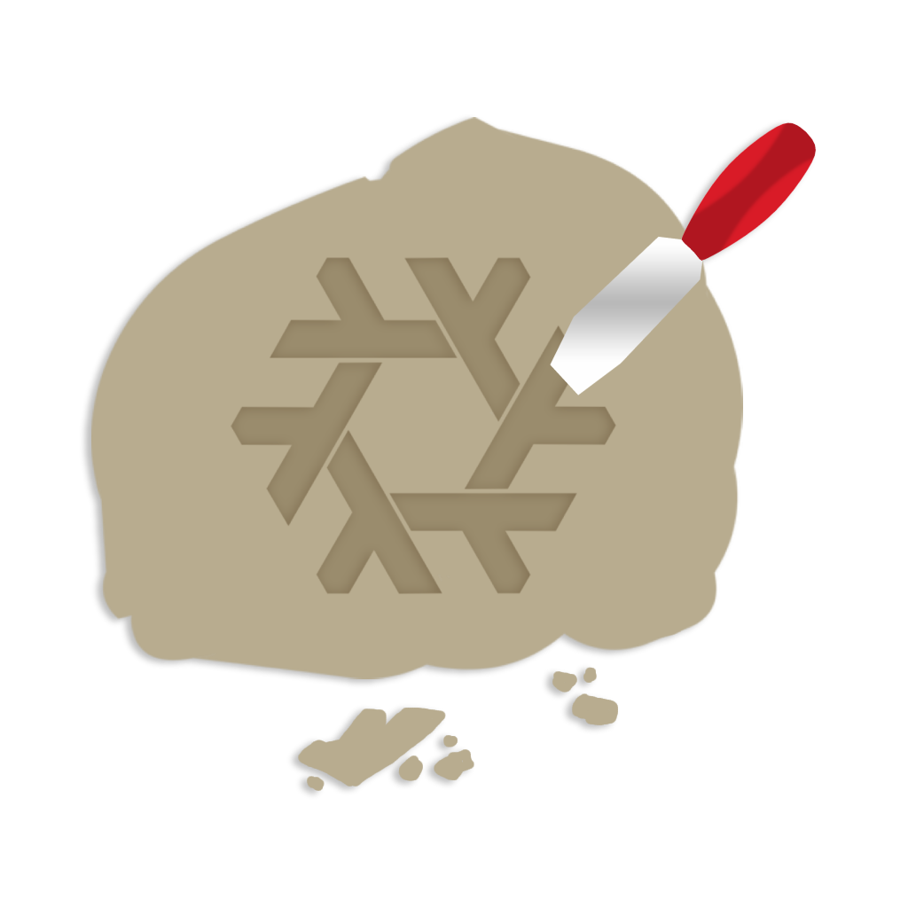

# Chiselix
Nix development environment for the [Chisel](https://github.com/ElgenTidwell/Chisel) game engine

## Usage
1. Ensure you have flakes enabled
2. Clone Chisel and run `nix develop github:polygonalbones/Chiselix`
3. Run `make-monogame-prefix`. This will setup a wine prefix at `~/.winemonogame` and install the components for you.
4. cd into `Editor/Rockwall2` and run `dotnet build`
5. profit